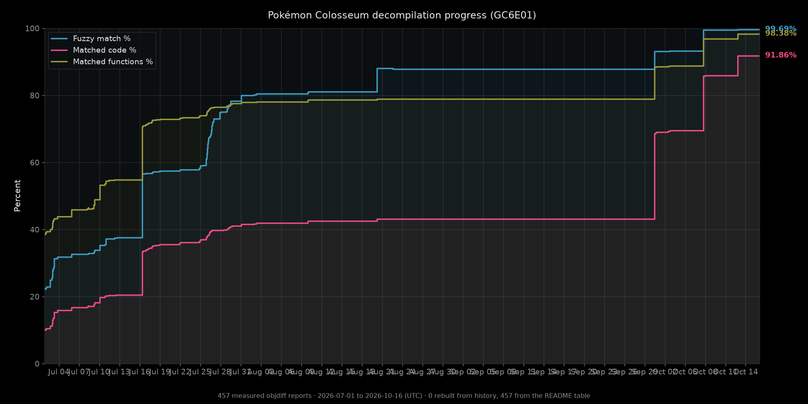

# Pokémon Colosseum Decompilation (GC6E01)

A matching decompilation project for the GameCube game **Pokémon Colosseum**
(`GC6E01`, NTSC-U). This repository continues the work of
[`dougchansan/pkmn-colosseum`](https://github.com/dougchansan/pkmn-colosseum)
and keeps the standard
[dtk-template](https://github.com/encounter/dtk-template) workflow.

## Status



Rendered locally from the README table's own git history: 457 measured `objdiff` reports
spanning 2026-07-01 to 2026-10-16, including the upstream history this repository continues
from. Re-render it with
`uv run --with matplotlib tools/plot_progress.py -o docs/progress.png`.

| Metric | Value |
|---|---|
| Fuzzy match | 99.69% |
| Function match | 98.44% (8,542 / 8,677 functions) |
| Code match | 92.01% (2,304,736 / 2,504,940 matched code bytes) |
| Data match | 99.23% (3,538,440 / 3,565,892 matched data bytes) |
| Source-linked | 1,973 / 2,169 units complete, 90.96% of units (code 90.62%, data 68.81%) |

"Matched" counts bytes that score. "Complete" counts bytes inside units that carry no
residue at all, which is why that row reports the unit, code and data figures
separately. They answer different questions and this project reports both.

The measurements above cover the **DOL and all 25 configured REL modules**, from
the full `build/GC6E01/report.json`. All 26 rebuilt binaries reproduce their
unchanged canonical SHA-1 hashes, so every output in the build is byte-identical to
the retail disc. This is a matching reconstruction with original fallback objects
where required, not a claim of gameplay testing.

### Change since upstream master `72c0603d6`

* Inline helper recovery closed `fn_80008C40` byte-exact, 1,336 B.
* Five `common_rel` units reconstructed, 1,338,904 B. Data went from 58.84% to 96.39%.
* 32 DOL zero-fill `.bss`/`.sbss` units converted to named declarations, 28,464 B.
* 27 pointer-free DOL `.data`/`.sdata` units converted, 1,443 B.
* 15 pointer-bearing DOL `.data`/`.sdata` units converted, 5,888 B.
* `data_80375938` and the `hsd/video` data reconstructed, 6,888 B.
* `GStextureConvertToHW` recovered from 92.50% to 95.30%.
* `tools/project.py` fixed so the dtk build runs natively on Windows.

Every verified win is recorded in
[`docs/decomp_wins_ledger.csv`](docs/decomp_wins_ledger.csv) with the unit, symbol,
before and after score, and byte count. 1,382,923 bytes closed to date.

### What is left, and why

* **141 residual functions, 203,792 code bytes.** 129 of them are dominated by
  register-colouring differences: the emitted instruction stream matches retail
  apart from which register holds which value. Measurement shows this project
  already allocates the same register set retail used, and that the extra freedom
  retail's compiler had was reusing a freed callee-saved slot, a decision inside
  the allocator that no source shape controls. A 632-candidate search over the
  transformation space, including exhaustive enumeration for the largest target,
  produced no improvement.
* **86,040 data bytes**, in three measured classes: dtk relocation-inference
  artifacts on tables that are otherwise correct, objects whose declared size does
  not match retail's slot, and 20 auto units where MWCC hard-codes a `.data`
  section alignment of 8 against 4-aligned retail bases.

Closing the remainder would need an allocator patch, asm bodies, or extracted
assets. All three are forbidden by this project's own policy, so the metric stops
here while the build stays byte-identical to retail.

## Requirements

You must provide your own legally obtained game files. Place a supported disc
image or extracted disc at `orig/GC6E01/`; see
[`docs/getting_started.md`](docs/getting_started.md).

The build downloads pinned dtk-template tools into `build/` when local paths are
not supplied.

## Build

```bash
python configure.py
ninja
python configure.py progress
```

The build splits `sys/main.dol` and the 25 configured original REL modules,
substitutes only objects declared in `configure.py`, and verifies all 26 rebuilt
outputs against `config/GC6E01/build.sha1`. Original RELs belong under
`orig/GC6E01/files/`; complete loose modules or their FSYS archives are supported.
All 24 FSYS archives named in `configure.py` are needed, not only the five listed
in `docs/REL_MODULES.md`.

### Windows

The build runs natively on Windows: the MWCC `.exe` compilers execute directly and
`sjiswrap.exe` wraps them, so no wibo or wine layer is required. Two upstream
assumptions were Linux-only and are fixed in `tools/project.py`:

1. The `*_constant_export` / `*_constant_import` rules chain a second command with
   `&&` without prefixing `CHAIN` (`cmd /c `). Ninja on Windows runs commands
   without a shell, so the `&&` reached `mwcceppc.exe` and 34 units aborted with
   `Unknown option '-object'`.
2. The MSYS-built `powerpc-eabi-ld.exe` strips backslashes when it expands an
   `@file` response file, collapsing every path inside it, which failed all 25 REL
   partial links. Windows now passes those inputs on the command line.

`sjiswrap: File ... contains Shift JIS encoding errors` lines are warnings about
UTF-8 bytes in the sources, not failures.

## Verifying a change

```bash
ninja
sha1sum -c config/GC6E01/build.sha1                          # 26/26 canonical
ninja build/GC6E01/report.json
python3 .github/scripts/check_metric_integrity.py build/GC6E01/report.json orig/GC6E01/sys/main.dol
python3 tools/check_object_map_freeze.py --report build/GC6E01/report.json --strict-source-status
python3 .github/scripts/check_regression.py <base>.json build/GC6E01/report.json
python3 .github/scripts/quality_scan.py <base> <head>
```

`check_object_map_freeze.py` locks total code bytes, data bytes, function count and
unit section topology. Progress counters may rise without updating the freeze;
intentional split or topology changes must update it in the same change with
`--update` and a stated reason. The freeze currently covers 2,165 units, and 21 of
them are auto-generated placeholders with a measured reason to stay that way.

Some measurement traps are worth knowing before trusting a number:

* A loose-object `objdiff-cli diff` score is not the metric. It counts
  relocation-name rows as residue that the report scores as matching, so it
  over-reports by up to 0.03 percentage points once register rows are present.
* An object-level check does not decide a unit, the link does. Units have been
  measured byte-identical to their target object that still moved the linked
  image, and a differing relocation set that still linked identically.
* Declaration order, per-unit compiler flags, pooled-symbol stand-ins and
  named-intermediate reshapes have all been measured inert on the residual set.
  The per-function record of which lever is already dead was kept with the working
  notes rather than published here, so treat those four classes as settled.
* `tools/update_readme_progress.py` rewrites the status table by matching the first
  table whose header is `Metric / Value`, then every following line that starts and
  ends with a pipe. Under `(?s)` that pattern spans newlines, so any second table
  later in this file is swallowed when the tool runs. Keep extra content out of
  tables, or fix the pattern, before running it.

## Worker Worktrees

Use the helper below for parallel decompilation workers. It creates or repairs a
worktree and links `orig/GC6E01/sys` to the local original game files so
`ninja all_source build/GC6E01/report.json` can validate from the worker tree.

```bash
python3 tools/setup_worker_worktree.py /tmp/pkmn-parallel-example \
  --branch campaign/parallel-example \
  --base origin/master
```

Add `--validate` to run the standard worker checks after setup:

```bash
python3 configure.py --no-progress
ninja all_source build/GC6E01/report.json
python3 tools/update_readme_progress.py --check
git diff --check
```

## Layout

```text
config/GC6E01/          dtk config, symbols, splits, SHA-1
include/                project headers
src/                    active source/data candidates declared in configure.py
tools/                  dtk-template helper scripts
docs/                   setup documentation, progress ledger
```

## Contributing

Use the dtk-template flow. Add or refine splits in `config/GC6E01/splits.txt`,
declare source objects in `configure.py`, build with `ninja`, and inspect the
generated `objdiff.json` / `build/GC6E01/report.json`.

Do not commit generated `.inc` files, extracted game assets, target objects,
compiler binaries, or asm-wrapper bodies as decompilation progress.

## Provenance

The decompiled source here is the work of
[`@dougchansan`](https://github.com/dougchansan) and the contributors of
[`dougchansan/pkmn-colosseum`](https://github.com/dougchansan/pkmn-colosseum),
carried forward in this repository by
[`@grant-might`](https://github.com/grant-might). The upstream repository tracks
the project's full history, its CI, and its progress chart; this one continues from
master `72c0603d6` and reports its own measured numbers.

## License

Released under the MIT license, see [LICENSE](LICENSE). The Pokémon Colosseum
game, assets, and toolchain are owned by their respective rights holders and are
not distributed here.
